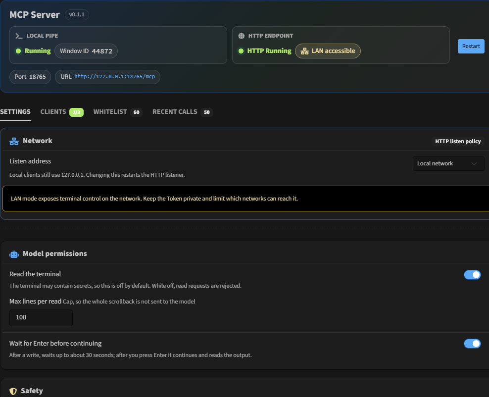
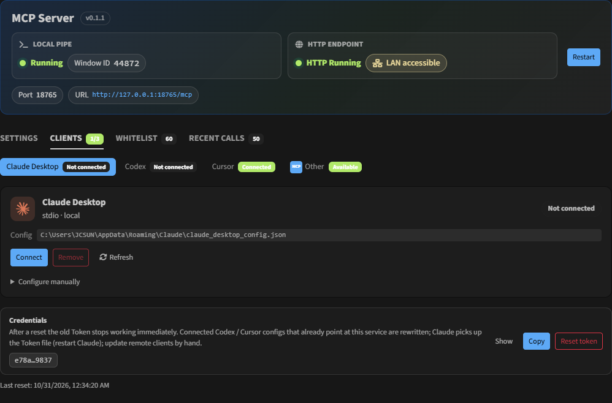
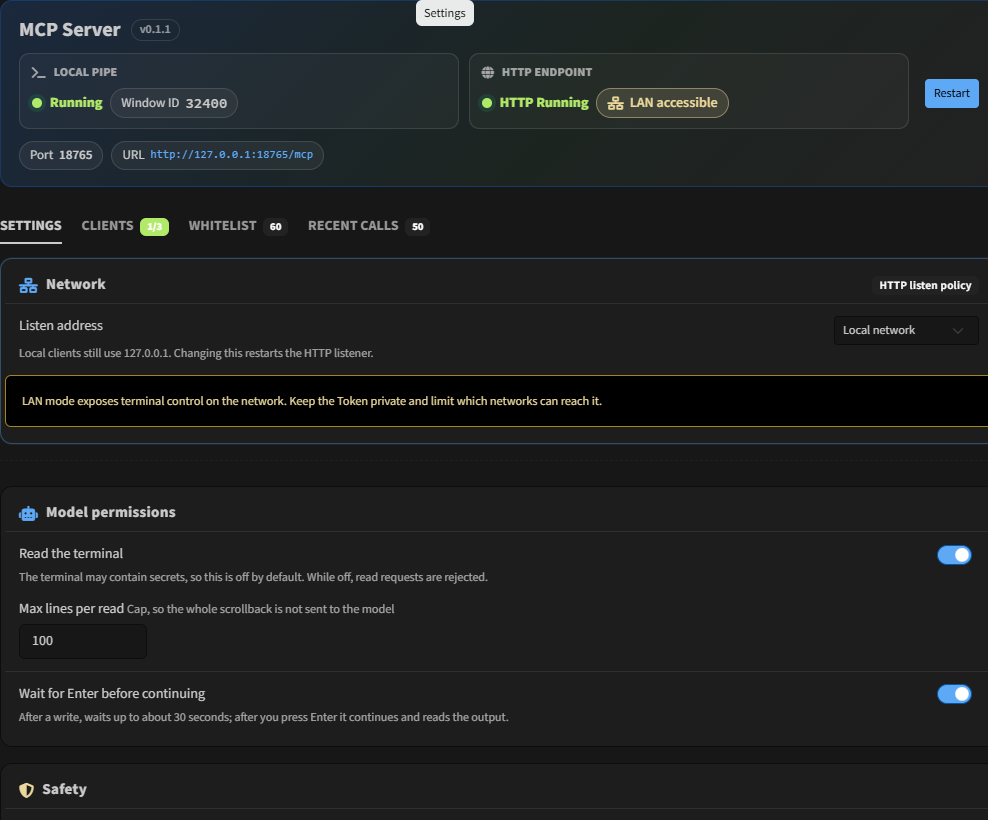

# tabby-mcp-jc

[](https://www.npmjs.com/package/tabby-mcp-jc)
[](https://www.npmjs.com/package/tabby-mcp-jc)
[](https://tabby.sh/)
[](https://modelcontextprotocol.io/)
[](https://creativecommons.org/licenses/by-nc/4.0/)

[English](README.md) | [简体中文](README.zh-CN.md)

**Give Claude Desktop, Codex/ChatGPT, and Cursor a safe window into your Tabby terminals** — list tabs, read the screen, and type commands. **The model never presses Enter.** You do.



## Install

1. Install [Tabby](https://tabby.sh/).
2. Open **Settings → Plugins**, search for `tabby-mcp-jc`, and install.
3. Or install from npm into a folder Tabby can load as a plugin (the Plugins UI is preferred once the package is indexed).

For local development: `pnpm build`, then start Tabby with `TABBY_PLUGINS` pointing at this repo. **Codex, Cursor, and HTTP do not need Node.** Claude Desktop's stdio shim and a local build need Node ≥ 20.

## Connect your AI client

In Tabby open **Settings → MCP Server → Clients**:

1. Pick **Claude Desktop**, **Codex**, or **Cursor**.
2. Click the one-click **Import / Install** button (stdio for Claude; Streamable HTTP for Codex and Cursor).
3. Turn on **Read the terminal** and **Wait for Enter before continuing** under **Config** if you want those tools.

That's it — whitelist and confirmation dialogs stay on for non-whitelisted commands.



## Screenshots

| Overview (dual lanes) | Clients | Config |
| --- | --- | --- |
|  |  |  |

## Four tools

| Tool             | What it does                                                                                                                                                                        |
|------------------|-------------------------------------------------------------------------------------------------------------------------------------------------------------------------------------|
| `list_tabs`      | Find local and SSH tabs                                                                                                                                                             |
| `read_terminal`  | Read the screen as plain text. Optional incremental `cursor` (pass the previous value back). After `write_terminal`, reading starts at the written line; otherwise the last N lines |
| `write_terminal` | Types text only. **Does not add a newline**                                                                                                                                         |
| `await_enter`    | Waits for you to press Enter (about 30s per call). Returns `submitted` or `timed_out`. Optional `include_output`                                                                    |

The usual sequence: `write_terminal` → you press Enter in Tabby → `await_enter` in the same turn. A timeout is not an error. The call is still waiting for you.

## Two transports

| Client             | How it connects                                                                                                                                                    |
|--------------------|--------------------------------------------------------------------------------------------------------------------------------------------------------------------|
| **Claude Desktop** | **stdio** (`node` + `dist/shim.js`; the token is read from a file; restart Claude after a token reset)                                                             |
| **Codex**          | **Streamable HTTP** (`url` + `Authorization: Bearer …`; a token reset rewrites only a TOML Bearer that already points at this service)                             |
| **Cursor**         | **Streamable HTTP** (user-level `~/.cursor/mcp.json`: `url` + `Authorization: Bearer …`; a token reset rewrites only an entry that already points at this service) |
| Cloud / remote     | The same HTTP endpoint, behind an HTTPS tunnel                                                                                                                     |

The pipe and the HTTP listener are **always on** (there is no master switch). **Streamable HTTP listens inside the Tabby process** (Node's built-in `http`, no extra `node.exe`). It binds to `127.0.0.1` by default; the client page can switch that to LAN `0.0.0.0`. The usual URL is `http://127.0.0.1:18765/mcp`. Claude Desktop's **stdio shim still needs a local Node** (`node` + `dist/shim.js`).

Settings → **Clients** → Streamable HTTP:

1. **Copy the connect prompt** (address, `Authorization: Bearer`, Streamable HTTP). You choose whether the copy includes the token.
2. **Public access** (collapsed by default: bind address, public URL, Cloudflare / Tailscale examples).

The toolbar button opens this plugin's settings. Its submenu can pause or resume the service for the current session; restarting Tabby turns it back on. Default shortcut: `Ctrl-Shift-M` toggles pause. The **Recent calls** tab shows the audit log.

```bash
cloudflared tunnel --url http://127.0.0.1:18765
```

## Safety

- Never presses Enter. `write_terminal` strips newlines.
- Text already sitting on the line returns `pending_input` and is left alone.
- Commands outside the whitelist open a confirm dialog. The **30 second** countdown runs only while that Tabby window is in the foreground, then **refuses**. Nothing is written on timeout. If the client disconnects, the dialog closes.
- `await_enter` is about 30s per call. It is separate from the confirm dialog.
- Reading and waiting are off by default.
- HTTP checks `Origin` (missing Origin, loopback, or the same site as `Host`). Bearer auth is always required. The bind address is configurable. Resetting the token in settings invalidates the old token immediately, and rewrites only client configs that already point at this service and still hold this service's token.

## Development

```bash
pnpm install && pnpm test && pnpm build
```

[CC BY-NC 4.0](https://creativecommons.org/licenses/by-nc/4.0/)

### UI colors

`src/styles/tabby-theme-vars.css` is editor-only (not bundled). At runtime Tabby/Bootstrap supplies `--bs-*`. Prefer `var(--bs-primary)`, `var(--bs-body-color)`, etc. in component styles instead of hard-coded hex.
