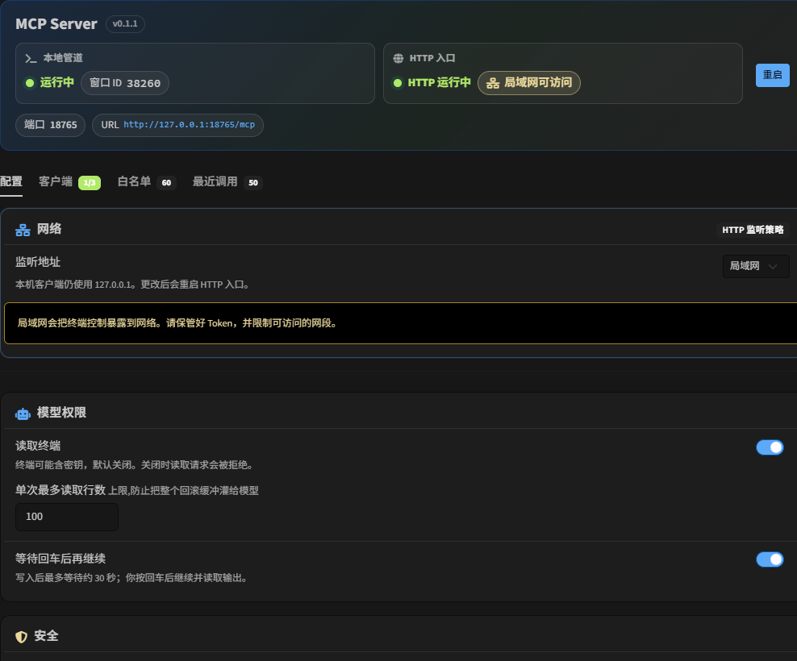
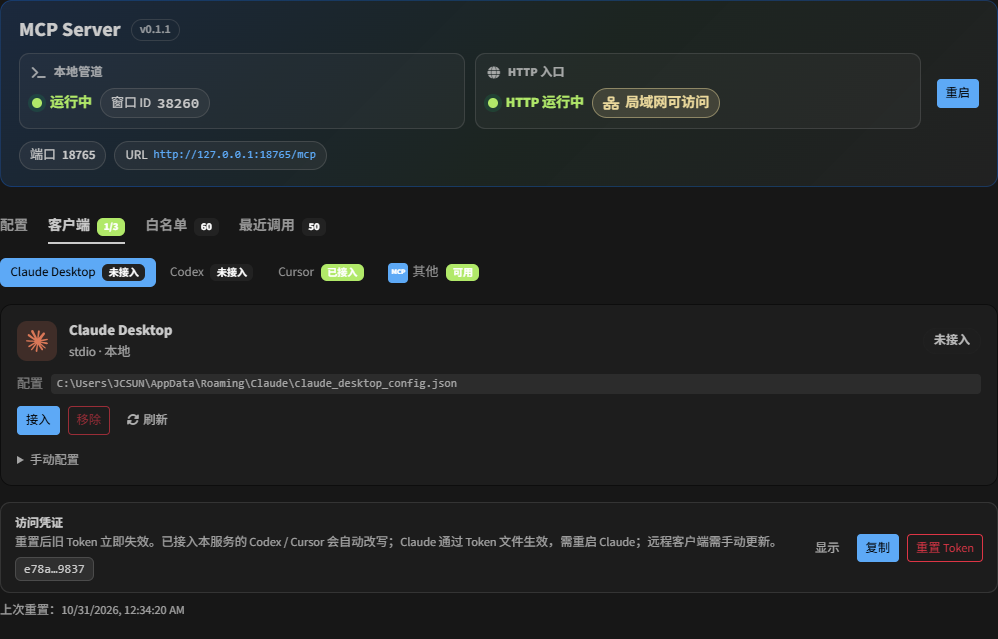
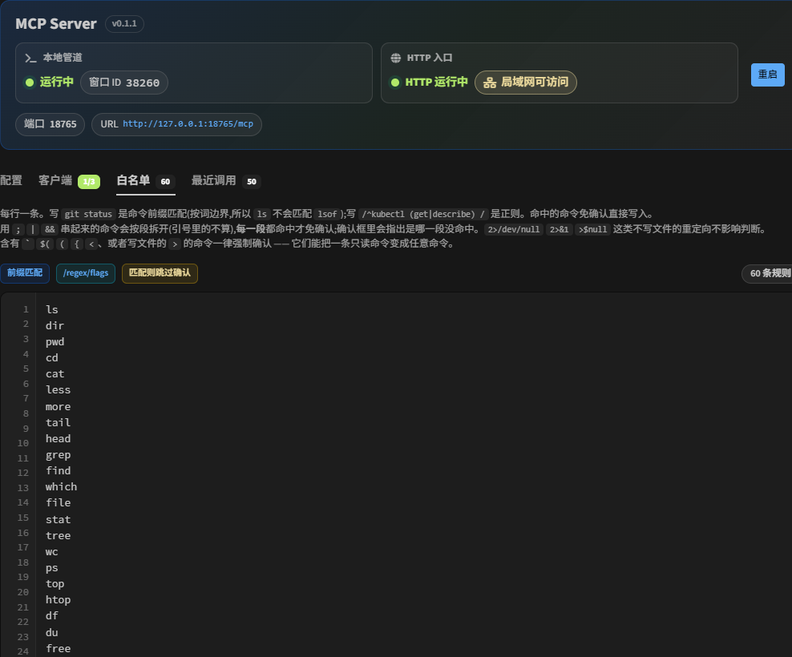

# tabby-mcp-jc

[](https://www.npmjs.com/package/tabby-mcp-jc)
[](https://www.npmjs.com/package/tabby-mcp-jc)
[](https://tabby.sh/)
[](https://modelcontextprotocol.io/)
[](https://creativecommons.org/licenses/by-nc/4.0/)

[English](README.md) | [简体中文](README.zh-CN.md)

**给 Claude Desktop、Codex/ChatGPT、Cursor 开一扇安全的 Tabby 终端窗口** — 列标签、读屏幕、把命令打进终端。**回车永远由你来按，模型不会替你按。**



## 安装

1. 安装 [Tabby](https://tabby.sh/)。
2. 打开 **设置 → 插件**，搜索 `tabby-mcp-jc` 并安装。
3. 也可从 npm 装到 Tabby 能加载的插件目录（插件库索引完成后，优先用设置里的插件页搜索安装）。

开发时：`pnpm build` 后用环境变量 `TABBY_PLUGINS` 指向本仓库目录启动 Tabby。**Codex / Cursor / HTTP 接入不需要 Node。** Claude Desktop 的 stdio shim 与本地构建仍需 Node ≥ 20。

## 接入你的 AI 客户端

在 Tabby 打开 **设置 → MCP Server → 客户端**：

1. 选择 **Claude Desktop**、**Codex** 或 **Cursor**。
2. 点一键 **导入 / 安装**（Claude 走 stdio；Codex 与 Cursor 走 Streamable HTTP）。
3. 若要用读屏或 `await_enter`，在 **配置** 中打开「读取终端」「等待回车后再继续」。

白名单外的命令仍会弹确认框，安全策略不变。



## 截图

| 总览（双通道） | 客户端 | 命令白名单 |
| --- | --- | --- |
|  |  |  |

## 四个工具

| 工具               | 干什么                                                                 |
|------------------|--------------------------------------------------------------------|
| `list_tabs`      | 找本地 / SSH 标签                                                       |
| `read_terminal`  | 读屏（纯文本）；可选增量 `cursor`（下次原样传回）；有过 `write_terminal` 就从写入行起读，否则末尾 N 行 |
| `write_terminal` | 只写入，**不加换行**                                                       |
| `await_enter`    | 挂起等你按回车（单次约 30s）；返回 `submitted` / `timed_out`；可加 `include_output`  |

固定套路：`write_terminal` → 你在 Tabby 按回车 → 同轮 `await_enter` 接着等。超时不是报错，是它还在等你。

## 两条通道

| 客户端                | 怎么连                                                                                                     |
|--------------------|----------------------------------------------------------------------------------------------------------|
| **Claude Desktop** | **stdio**（`node` + `dist/shim.js`，token 读文件，重置 Token 后需重启 Claude）                                       |
| **Codex**          | **Streamable HTTP**（`url` + `Authorization: Bearer …`；重置 Token 时仅改写已接入本服务的 TOML Bearer）                 |
| **Cursor**         | **Streamable HTTP**（用户级 `~/.cursor/mcp.json`：`url` + `Authorization: Bearer …`；重置 Token 时仅改写已接入本服务的条目） |
| 云端 / 远程            | 同一 HTTP；外面再套一条 HTTPS 隧道                                                                                  |

管道和 HTTP 入口**始终启用**（无总闸）。**Streamable HTTP 在 Tabby 进程内直接监听**（Node 内置 `http`，不另起 `node.exe`；默认绑 `127.0.0.1`，客户端接入页可改局域网 `0.0.0.0`）。默认地址 `http://127.0.0.1:18765/mcp`。Claude Desktop 的 **stdio shim 仍需本机 Node**（`node` + `dist/shim.js`）。

设置 → **客户端** → Streamable HTTP：

1. **一键复制接入提示词**（地址 / `Authorization: Bearer` / 请求方式 Streamable HTTP；复制前可选含不含 token）
2. **如何配置公网**（默认折叠：监听地址、公网 URL、Cloudflare / Tailscale 示例）

工具栏按钮单击打开本插件设置页；子菜单可「全部断开并暂停 / 恢复服务」（仅本会话；重启 Tabby 自动恢复）。默认快捷键：`Ctrl-Shift-M` 切换暂停。设置页「最近调用」可查看审计日志。

```bash
cloudflared tunnel --url http://127.0.0.1:18765
```

## 安全

- 永不代按回车；`write_terminal` 会剥掉换行
- 行上已有未提交输入 → `pending_input`，不硬写
- 白名单外弹确认：倒计时只在这个 Tabby 窗口处于前台时累计 **30 秒**，超时 **自动拒绝**（不会偷偷写入）。调用方断开时确认框会关闭
- `await_enter` 单次约 30s；跟确认框是两回事
- 读屏 / 等待默认关着
- HTTP：Origin 校验（无 Origin / loopback / 与 Host 同站）、Bearer 始终必需、绑定可配；设置页可一键重置 Token（旧 token 立刻失效；仅改写已接入本服务且 Bearer 仍为本服务 token 的客户端配置）

## 开发

```bash
pnpm install && pnpm test && pnpm build
```

[CC BY-NC 4.0](https://creativecommons.org/licenses/by-nc/4.0/deed.zh)

### 界面颜色

`src/styles/tabby-theme-vars.css` 只给编辑器占位，不参与打包。运行时由 Tabby/Bootstrap 提供 `--bs-*`。组件样式请用 `var(--bs-primary)`、`var(--bs-body-color)` 等，不要写死十六进制色值。
